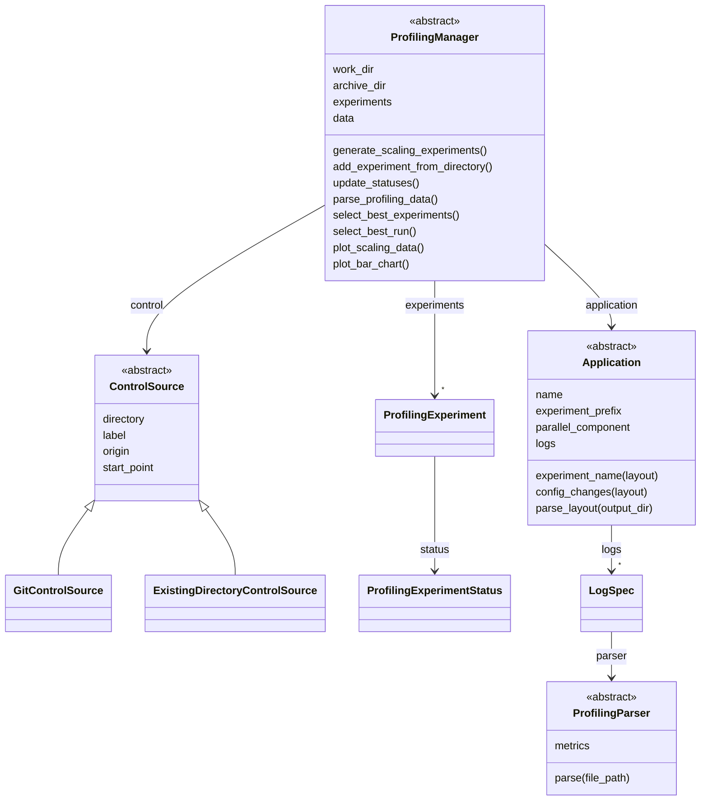
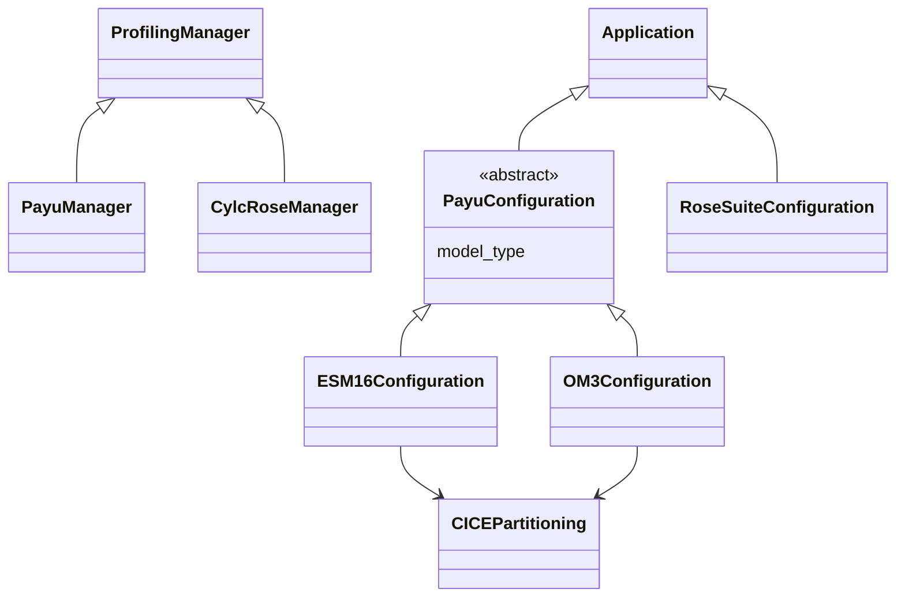
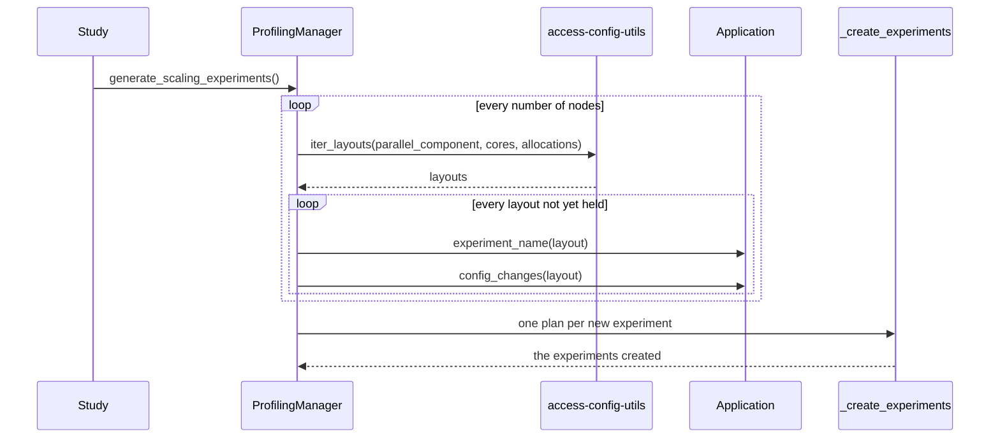

# Architecture

The package is organised along two axes, described here for developers who want to change it or extend it to a
new application, a new log format or a new workflow engine. The [User guide](../user-guide/index.md) introduces
the same pieces from the point of view of running a study.

## Two axes, and the line between them

A profiling study varies along two independent axes. What is run, which application set up in which way, is the
application. How it is run, which workflow engine generates, submits and archives its experiments, is the manager.
Every member of the package sits on one side of that line, decided by which side it reads from:

- The manager reads what the workflow engine and the scheduler wrote: the run directories, the job records, the
  number of CPUs a job was charged for.
- The application reads what its own configuration files say: how a layout is written into them and read back
  out of them, and where its components write their profiling logs.

An application is therefore data, and not a subclass of a manager. Two setups of one application are two values
of one configuration class, a subclass of `Application`, and a new application is a new configuration class, which
any manager whose engine runs it can drive. Where a control comes from is a third, independent choice, so every
manager accepts every control source.

## Classes

### The general classes

A manager is generic in the type of application its engine runs, and a control source records where a control
comes from, whichever engine runs it.

### The implementations for the ACCESS models

`PayuManager` drives `PayuConfiguration`s and `CylcRoseManager` drives `RoseSuiteConfiguration`s. The presets, such
as `ESM16_PI_CONTROL`, are values of the configuration classes, not classes of their own. The parsers for the logs
of the ACCESS models, one per log format, are listed in [Log formats](../access/log-formats.md).

## Contracts

To extend the package, you implement one of these abstract classes:

| Class | To implement | Guide |
|---|---|---|
| [`Application`][access.profiling.application.Application] | `parallel_component`, `logs`, `experiment_name`, `config_changes` and `parse_layout`, and the `name` and `experiment_prefix` attributes | [Adding an application](adding-an-application.md) |
| [`ProfilingParser`][access.profiling.parser.ProfilingParser] | `parse`, and the `_metrics` it reports | [Adding a parser](adding-a-parser.md) |
| [`ProfilingManager`][access.profiling.manager.ProfilingManager] | `profiling_logs`, `parse_ncpus`, `parse_status`, `_create_experiments`, `run_experiments` and `_delete_experiments` | |
| [`ControlSource`][access.profiling.control.ControlSource] | `origin` and `provenance`, and the `directory`, `label` and `start_point` attributes | |
| [`PayuConfiguration`][access.profiling.payu_configuration.PayuConfiguration] | For an application run with Payu: as `Application`, plus the `model_type` attribute | [Adding an application](adding-an-application.md) |

A new workflow engine is a new subclass of `ProfilingManager`. Choosing which experiments to generate, selecting
the best ones and plotting them are the same for every engine, so the base class implements them. A subclass only
says what its engine does: where it puts its logs, how many CPUs a job occupied, what state a run reached, and how
experiments are created, run and deleted.

## Generating a study

[`generate_scaling_experiments`][access.profiling.manager.ProfilingManager.generate_scaling_experiments] decides
what to generate, whether the layouts of several sizes or of one, in the base class, and leaves creating it to the
engine:

The plans hold everything that differs between the experiments: their names, their layouts, the changes to the
control's files and their walltimes. The manager only registers the experiments once the engine has created all
of them, so a generation that fails registers nothing, and calling it again generates what is missing.

## What comes from elsewhere

[access-config-utils](https://github.com/ACCESS-NRI/access-config-utils) provides the layout search: the component
trees (`ParallelComponent`), the layouts (`ComponentLayout`), the grids (`Domain`), the allocation strategies, the
constraints and `iter_layouts`. It also provides the parsers of configuration file formats, such as `YAMLParser` and
`NUOPCParser`, that the configurations of the ACCESS models read their files back with. The Payu manager creates
experiments with [experiment-generator](https://access-experiment-generator.access-hive.org.au/) and runs them with
[experiment-runner](https://access-experiment-runner.access-hive.org.au/), which in turn drive
[Payu](https://payu.readthedocs.io/en/stable/).
