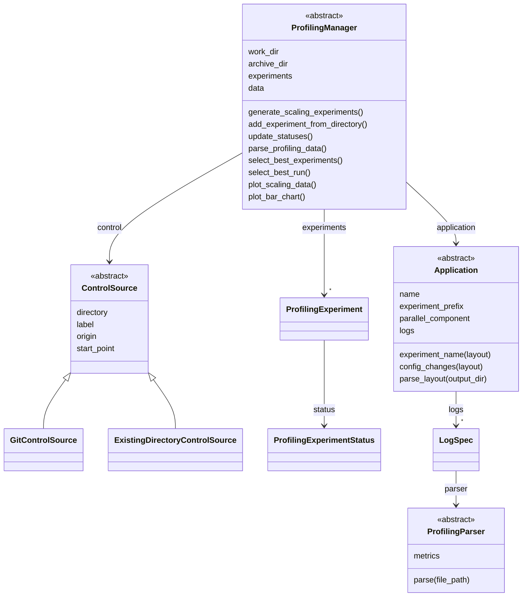
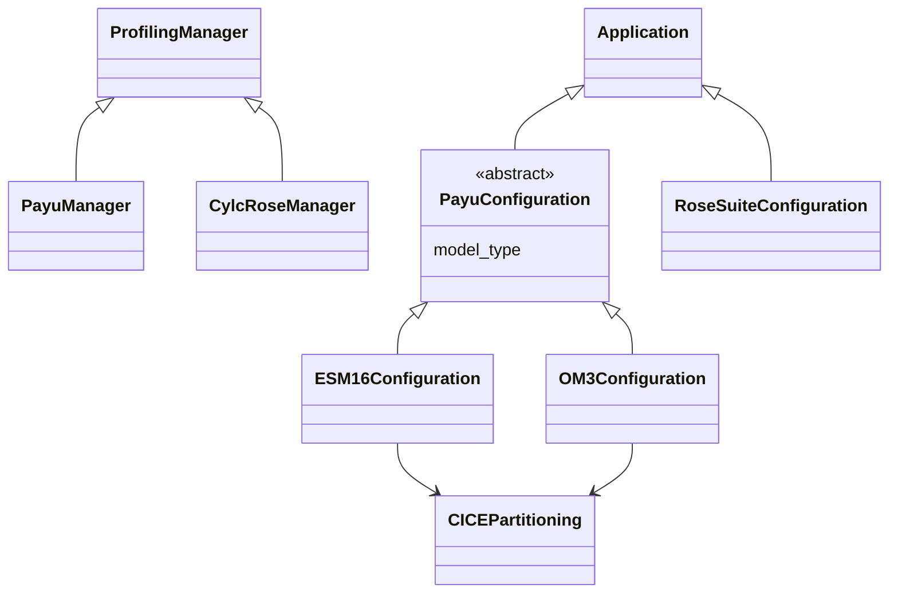
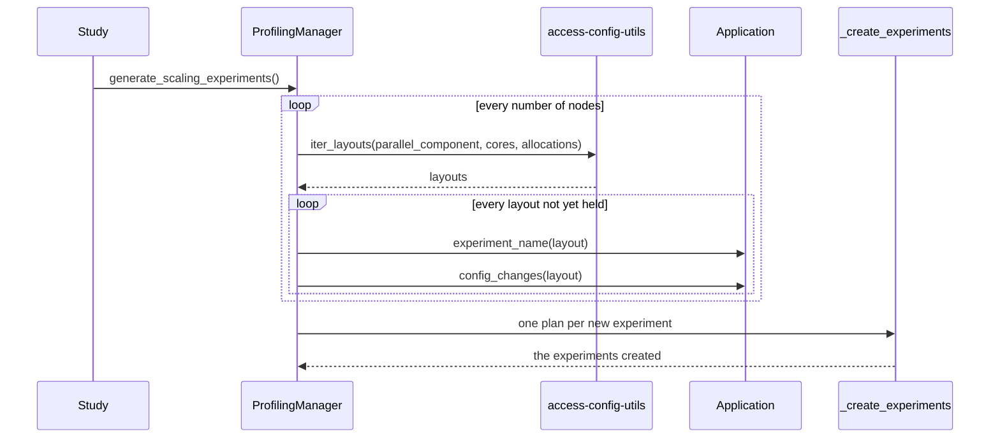

# Architecture

If you want to change the package, or to add a new application, a new log format or a new workflow engine, this
is the place to start. Here you will find how the package is organised and why. The same pieces are introduced
in the [User guide](../user-guide/index.md), from the point of view of someone running a study.

## Two axes, and the line between them

The package separates two questions. The first is what is run, and this is the application. The second is how it
is run, in other words which workflow engine creates, submits and archives the experiments, and this is the
manager. Everything in the package belongs to one side or the other. The rule to decide is simple, and depends on
where the information comes from:

- The manager reads what the workflow engine and the scheduler wrote: the run directories, the job records, the
  number of CPUs a job was charged for.
- The application reads what its own configuration files say: how a parallelisation layout is written into them and read
  back out of them, and where its components write their profiling logs.

This means that an application is just data, which is given to a manager. Each application has a configuration
class, which is a subclass of `Application`, and two configurations of the same application are simply two
instances of that class. To support a new application, you write a new configuration class, and it then works with
any manager whose workflow engine can run it. The control is a third, independent choice, so every manager works
with every control source.

## Classes

### The general classes

A manager is generic in the type of application that its workflow engine runs. A control source only says where
the control is, and does not depend on the workflow engine.

### The implementations for the ACCESS models

`PayuManager` works with `PayuConfiguration`s, and `CylcRoseManager` with `RoseSuiteConfiguration`s. Note that
the presets, such as `ESM16_PI_CONTROL`, are instances of the configuration classes, and not classes of their own.
There is also one parser for each log format of the ACCESS models, and they are listed in
[Log formats](../access/log-formats.md).

## Contracts

To extend the package, you implement one of these abstract classes:

| Class | To implement | Guide |
|---|---|---|
| [`Application`][access.profiling.application.Application] | `parallel_component`, `logs`, `experiment_name`, `config_changes` and `parse_layout`, and the `name` and `experiment_prefix` attributes | [Adding an application](adding-an-application.md) |
| [`ProfilingParser`][access.profiling.parser.ProfilingParser] | `parse`, and the `_metrics` it reports | [Adding a parser](adding-a-parser.md) |
| [`ProfilingManager`][access.profiling.manager.ProfilingManager] | `profiling_logs`, `parse_ncpus`, `parse_status`, `_create_experiments`, `run_experiments` and `_delete_experiments` | |
| [`ControlSource`][access.profiling.control.ControlSource] | `origin` and `provenance`, and the `directory`, `label` and `start_point` attributes | |
| [`PayuConfiguration`][access.profiling.payu_configuration.PayuConfiguration] | For an application run with Payu: as `Application`, plus the `model_type` attribute | [Adding an application](adding-an-application.md) |

To support a new workflow engine, you write a new subclass of `ProfilingManager`. Most of the work is already
done by the base class: choosing which experiments to create, selecting the best ones and plotting them are the
same for every workflow engine. The subclass only has to deal with what is specific to its engine. This is where
the logs are, how many CPUs a job used, what the status of a run is, and how experiments are created, run and
deleted.

## Generating a study

As an example of how this works, let us look at how the experiments of a study are created.
[`generate_scaling_experiments`][access.profiling.manager.ProfilingManager.generate_scaling_experiments], in the
base class, decides which experiments are needed. Actually creating them is left to the subclass:

A plan has everything that is different from one experiment to the next: its name, its layout, the changes to
the files of the control and its walltime. Note that the manager only registers the experiments once all of them
have been created. If something fails on the way, nothing is registered, and you can simply call the method again
to create what is missing.

## What comes from elsewhere

Not everything is done by this package. The search for layouts comes from
[access-config-utils](https://github.com/ACCESS-NRI/access-config-utils). This includes the component trees
(`ParallelComponent`), the layouts (`ComponentLayout`), the grids (`Domain`), the allocation strategies, the constraints
and `iter_layouts`. The same package has parsers for configuration files, such as `YAMLParser` and `NUOPCParser`, which
the ACCESS models use to read their files. The Payu manager creates experiments with
[experiment-generator](https://access-experiment-generator.access-hive.org.au/) and runs them with
[experiment-runner](https://access-experiment-runner.access-hive.org.au/), which in turn drive
[Payu](https://payu.readthedocs.io/en/stable/).
