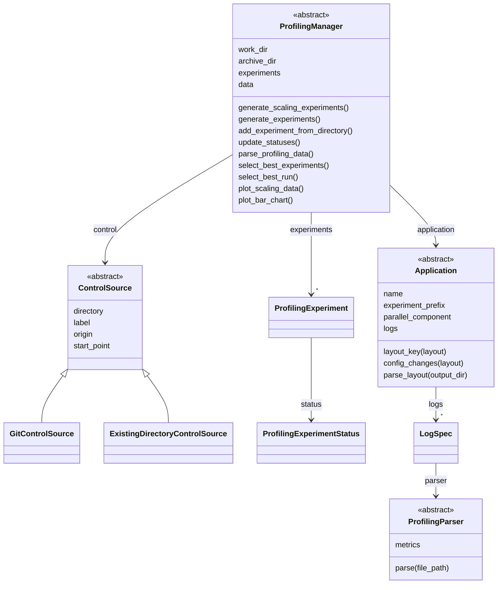
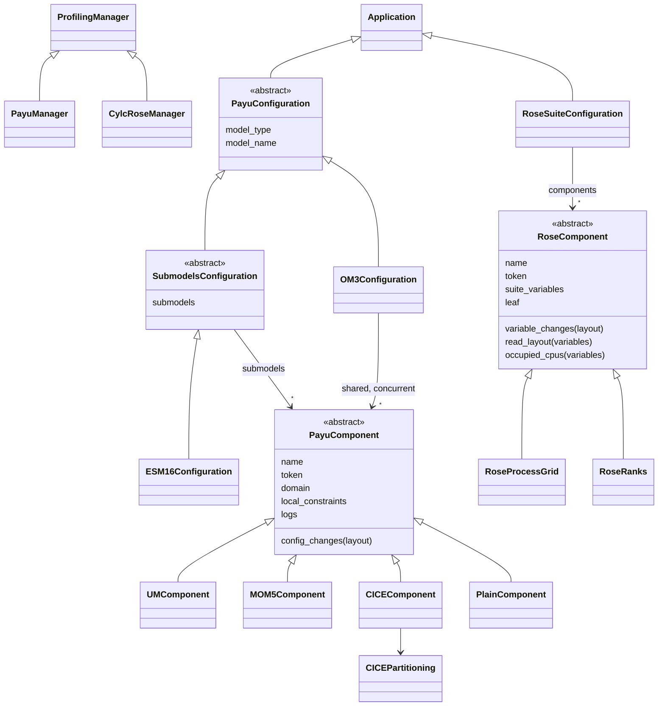
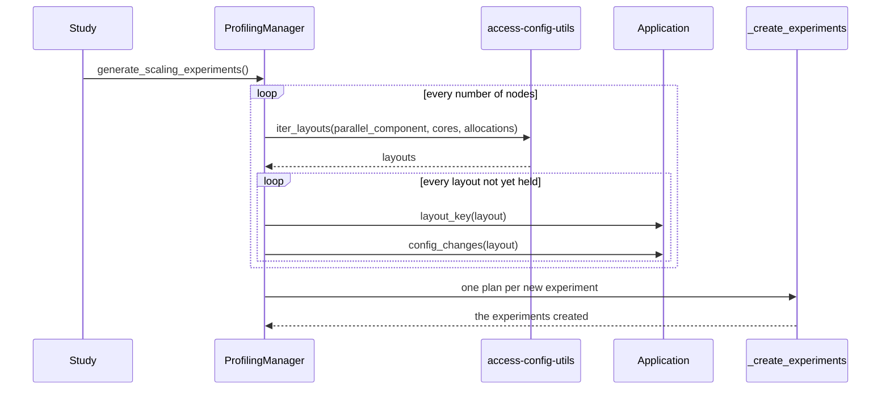

# Architecture

If you want to change the package, or to add a new application, a new log format or a new workflow engine, this
is the place to start. Here you will find how the package is organised and why. The same pieces are introduced
in the [User guide](../user-guide/index.md), from the point of view of someone running a study.

## Two axes, and the line between them

The package separates two questions. The first is what is run, and this is the application. The second is how it
is run, in other words which workflow engine creates, submits and archives the experiments, and this is the
manager. Everything in the package belongs to one side or the other. The rule to decide is simple, and depends on
where the information comes from:

- The manager reads what the workflow engine and the scheduler wrote: the run directories, the job records, the
  number of CPUs a job was charged for.
- The application reads what its own configuration files say: how a parallelisation layout is written into them and read
  back out of them, and where its components write their profiling logs.

This means that an application is just data, which is given to a manager. Each application has a configuration
class, which is a subclass of `Application`, and two configurations of the same application are simply two
instances of that class. To support a new application, you write a new configuration class, and it then works with
any manager whose workflow engine can run it. The control is a third, independent choice, so every manager works
with every control source.

## Classes

### The general classes

A manager is generic in the type of application that its workflow engine runs. A control source only says where
the control is, and does not depend on the workflow engine.

### The implementations for the ACCESS models

`PayuManager` works with `PayuConfiguration`s, and `CylcRoseManager` with `RoseSuiteConfiguration`s. Note that
the presets, such as `ESM16_PI_CONTROL`, are instances of the configuration classes, and not classes of their own.
A Payu model is put together from components, one for each code that it runs. A component says what its code
decomposes, what it writes and which logs it produces. `ESM16Configuration`, for example, pairs the UM, MOM5 and
CICE components with the submodels of its control. It does this through `SubmodelsConfiguration`, which writes and
reads the layout of any model that Payu couples in this way. `OM3Configuration` builds the tree that NUOPC lays
out from the same components. A Rose suite is put together from components too, but of its own kind, since what a
Rose component knows is which variables of `rose-suite.conf` state its layout. A `RoseProcessGrid` is a code that
divides a grid along a process grid, such as the UM, and a `RoseRanks` is one given a number of ranks and nothing
else. `RoseSuiteConfiguration` writes and reads the layout of every suite from them, so a suite is a value rather
than a class. There is also one parser for each log format of the ACCESS models, and they are listed in
[Log formats](../access/log-formats.md).

## Contracts

To extend the package, you implement one of these abstract classes:

| Class | To implement | Guide |
|---|---|---|
| [`Application`][access.profiling.application.Application] | `parallel_component`, `logs`, `layout_key`, `config_changes` and `parse_layout`, and the `name` and `experiment_prefix` attributes | [Adding an application](adding-an-application.md) |
| [`ProfilingParser`][access.profiling.parser.ProfilingParser] | `parse`, and the `_metrics` it reports | [Adding a parser](adding-a-parser.md) |
| [`ProfilingManager`][access.profiling.manager.ProfilingManager] | `profiling_logs`, `parse_ncpus`, `parse_status`, `_create_experiments`, `run_experiments` and `_delete_experiments` | |
| [`ControlSource`][access.profiling.control.ControlSource] | `origin` and `provenance`, and the `directory`, `label` and `start_point` attributes | |
| [`PayuConfiguration`][access.profiling.payu_configuration.PayuConfiguration] | For an application run with Payu: as `Application`, plus the `model_type` and `model_name` attributes | [Adding an application](adding-an-application.md) |
| [`SubmodelsConfiguration`][access.profiling.payu_configuration.SubmodelsConfiguration] | For a Payu model whose components are its submodels: `submodels`, from the fields of a frozen dataclass | [Adding an application](adding-an-application.md) |
| [`PayuComponent`][access.profiling.payu_configuration.PayuComponent] | For one code of a Payu model: `domain`, `local_constraints` and `config_changes`, and the `name`, `token` and `logs` attributes | [Adding an application](adding-an-application.md) |
| [`RoseComponent`][access.profiling.rose_configuration.RoseComponent] | For one code of a Rose suite: `suite_variables`, `leaf`, `variable_changes`, `read_layout` and `occupied_cpus`, and the `name` and `token` attributes | [Cylc Rose suites](../access/cylc-rose-suites.md#other-suites) |

To support a new workflow engine, you write a new subclass of `ProfilingManager`. Most of the work is already
done by the base class: choosing which experiments to create, selecting the best ones and plotting them are the
same for every workflow engine. The subclass only has to deal with what is specific to its engine. This is where
the logs are, how many CPUs a job used, what the status of a run is, and how experiments are created, run and
deleted. The layout of an experiment that was given none is read from the files of the experiment directory by
default. An engine that keeps a copy of the configuration a run used overrides `_parse_layout`, so that the layout
and the CPU count come from the same file, as `CylcRoseManager` does.

## Generating a study

As an example of how this works, let us look at how the experiments of a study are created.
[`generate_scaling_experiments`][access.profiling.manager.ProfilingManager.generate_scaling_experiments], in the
base class, decides which experiments are needed. Actually creating them is left to the subclass:

A plan has everything that is different from one experiment to the next: its name, its layout, the changes to
the files of the control and its walltime. The name is a number, `exp-0001` onwards. The manager tells whether it
already holds an experiment for a layout from the key the application gives the layout, never from a name. Note that
the manager only registers the experiments once all of them have been created. If something fails on the way,
nothing is registered, and you can simply call the method again to create what is missing.

The numbers of the new experiments are taken before `_create_experiments` is called, and they stay taken if it
fails, because the engine may have created some of the experiments. A subclass can avoid this for what it is able
to check beforehand. It overrides `_refuse_plans`, which the manager calls with the plans before it writes
anything, and raises there. A call that is refused in this way takes no number. For example, this is where
`PayuManager` refuses a manager that has no `lab_dir`. By default, `_refuse_plans` refuses nothing.

[`generate_experiments`][access.profiling.manager.ProfilingManager.generate_experiments] goes the same way, without
a search. It makes one plan for each
[`ConfigurationChoice`][access.profiling.experiment.ConfigurationChoice] that the study states:

- For a choice without a layout, the changes of the plan are those of the choice, and the application is not
  asked anything.
- For a choice with a layout, the manager asks the application for `config_changes(layout)`, and merges the
  changes of the choice over them. Mappings are merged key by key and the choice wins. Two lists for the same key
  raise a `ValueError`.

Such a plan has no walltime, since a choice states its walltime among its changes, and it may have no layout. A
subclass of `ProfilingManager` therefore has to accept both in `_create_experiments`. The manager tells whether it
already holds the experiment of a choice from the key of its layout and from the changes that the choice states.

Once the experiments are created, the manager writes a record for each of them, and adds the call to the study
file. [Managing experiments](../user-guide/managing-experiments.md#what-the-manager-keeps-on-disk) describes both
files.

## What comes from elsewhere

Not everything is done by this package. The search for layouts comes from
[access-config-utils](https://github.com/ACCESS-NRI/access-config-utils). This includes the component trees
(`ParallelComponent`), the layouts (`ComponentLayout`), the grids (`Domain`), the allocation strategies, the constraints
and `iter_layouts`. The same package has parsers for configuration files, such as `YAMLParser` and `NUOPCParser`, which
the ACCESS models use to read their files. The Payu manager creates experiments with
[experiment-generator](https://access-experiment-generator.access-hive.org.au/) and runs them with
[experiment-runner](https://access-experiment-runner.access-hive.org.au/), which in turn drive
[Payu](https://payu.readthedocs.io/en/stable/).
