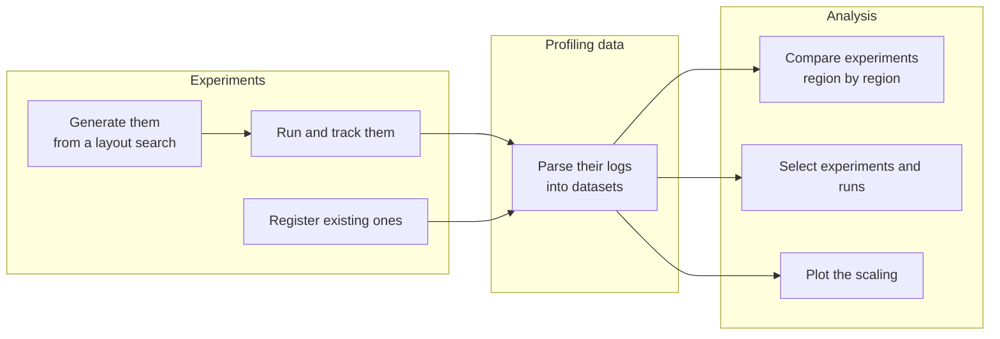

# access-profiling

access-profiling is a package aimed at simplifying and automating the process of profiling and optimising parallel
applications. It has been developed with the ACCESS climate models in mind, but it is general enough to be useful
for any type of parallel application. It has been designed to be light-weight and easily extensible. It is not
meant to replace other specialised profiling and optimising tools, but rather to complement them.

## What it provides

A profiling study is defined by three independent parts, which are introduced in more detail in the
[Concepts](user-guide/index.md#applications-managers-and-controls) section:

- the **application**, what is profiled: how it is parallelised, what files need to be edited and how, and what
  profiling logs it writes;
- the **manager**, how it is run: it creates, runs and records the experiments;
- the **control**, the experiment that is modified to create other experiments.

### Experiments

- The manager [generates](user-guide/experiments.md) experiments from the control, where its workflow engine
  allows it, and runs them.
- It is also possible to [register](user-guide/comparing-experiments.md#registering-experiments) existing
  experiments that were run in some other way.
- The manager [follows the status](user-guide/managing-experiments.md) of every experiment, allowing you to rerun
  the failed ones.
- The manager can also archive and delete existing experiments.

### Profiling data

- [Parsers](user-guide/logs-and-metrics.md) read the profiling logs of the application and of the workflow engine.
  Every log ends up in the same form, an [xarray](https://docs.xarray.dev/en/stable/) dataset with the timings of
  each region and their units.
- If an experiment ran several times, the timings of each run are kept separately.

### Analysis

- You choose which regions to look at, and how to label them, with
  [region groups](user-guide/analysing-data.md#choosing-the-regions).
- Bar charts compare experiments side by side, region by region.
- Scaling plots show the speedup and the parallel efficiency of the application and of each of its components.
- It is also possible to select the fastest experiment for each number of cores, and the fastest run of each
  experiment.
- The datasets are plain xarray, so you can do any other analysis yourself.

### Extending it

You can add a new application, a new log format or a new workflow engine. The
[Developer guide](developer-guide/index.md) explains how the package is organised, and
[Adding an application](developer-guide/adding-an-application.md) and
[Adding a parser](developer-guide/adding-a-parser.md) show how to add the first two.

## Studies

The package can be used for different kinds of profiling study. Each kind has a guide:

- [Comparing experiments](user-guide/comparing-experiments.md): put experiments that differ in build,
  configuration or parallelisation layout side by side, region by region.
- [Run-to-run variability](user-guide/run-to-run-variability.md): run the same experiment several times, and see
  how much its timings vary.
- [Best layout for a budget](user-guide/best-layout.md): run every layout of one number of cores, and pick the
  fastest.
- [Scaling studies](user-guide/scaling-studies.md): run an application on several numbers of cores, and plot how
  well it and its components scale.

## The ACCESS models

The package comes with everything needed to profile the [ACCESS climate models](access/index.md) developed at
[ACCESS-NRI](https://github.com/ACCESS-NRI), which run on NCI's Gadi supercomputer.

### Workflow engines

- [Payu](access/payu.md): `PayuManager` generates the experiments with
  [experiment-generator](https://access-experiment-generator.access-hive.org.au/), and runs them with
  [experiment-runner](https://access-experiment-runner.access-hive.org.au/).
- [Cylc and Rose](access/cylc-rose-suites.md): `CylcRoseManager` runs suites that you have prepared by hand.

### Log formats

There are [parsers](access/log-formats.md) for the timers of FMS (MOM5 and MOM6), ESMF, CICE and the UM, as well as
for the records Payu and Cylc keep of each run.

### Models

| Model | Preset | Workflow engine |
|---|---|---|
| ACCESS-ESM1.5 | `ESM15_PREINDUSTRIAL` | Payu |
| ACCESS-ESM1.6 | `ESM16_PI_CONTROL` | Payu |
| ACCESS-OM2 | `OM2_1DEG` | Payu |
| ACCESS-OM3 | `OM3_MC_25KM` | Payu |
| ACCESS-AM3 | `AM3_N96E`, `AM3_N512E` | Cylc and Rose |
| ACCESS-rAM3 | `RAM3` | Cylc and Rose |
| ACCESS-CM3 | `CM3_O25KM` | Cylc and Rose |

For the four Payu models, the package generates the experiments for you. For the other three, you prepare the
suites by hand. In both cases the profiling data is parsed, plotted and compared in the same way. If you want to
profile another configuration of one of these models, you do not need to write any code:
[ACCESS models](access/index.md) describes each preset and shows how. The
[access-model-scaling](https://github.com/ACCESS-NRI/access-model-scaling) repository holds the scaling studies of
the ACCESS models that were done with this package.

## Where to go next

- If you are new to the package, start with [Getting started](getting-started.md). It installs the package and
  shows the parallelisation layouts a study of ACCESS-ESM1.6 could run, without running anything.
- The [User guide](user-guide/index.md) introduces the concepts, shows how to run experiments and analyse their
  data, and has a guide for each kind of study.
- [ACCESS models](access/index.md) describes what the package provides for the ACCESS climate models.
- The [Developer guide](developer-guide/index.md) explains how the package is organised and how to extend it.
- The [API reference](api/index.md) documents every class and function.

## Getting help

If you have a question, ask on the [ACCESS Hive Forum](https://forum.access-hive.org.au/), or open an issue on
[GitHub](https://github.com/ACCESS-NRI/access-profiling/issues).
