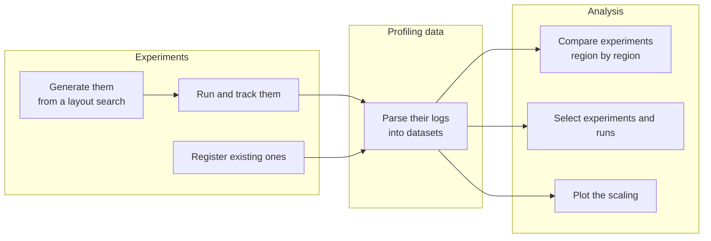

# access-profiling

access-profiling is a package aimed at simplifying and automating the process of profiling and optimising parallel
applications. It has been developed with the ACCESS climate models in mind, but it is general enough to be useful
for any type of parallel application. It has been designed to be light-weight and easily extensible. It is not
meant to replace other specialised profiling and optimising tools, but rather to complement them.

## What it provides

A study is defined by three independent parts, which [Concepts](user-guide/index.md#applications-managers-and-controls)
introduces:

- the **application**, what is profiled: the parallel components it runs and the cores each can be given, how a
  layout is written into its configuration files and read back out of them, and the profiling logs its runs write;
- the **manager**, how it is run: it drives one workflow engine, which runs the experiments and records what became
  of them;
- the **control**, the configuration every experiment changes, wherever it comes from.

### Experiments

- A [layout search](user-guide/index.md#layouts), through
  [access-config-utils](https://github.com/ACCESS-NRI/access-config-utils), finds every way of dividing a number of
  cores among an application's components that the application can run and the study asks for.
- The manager [generates](user-guide/experiments.md) one experiment from the control for each layout, where its
  workflow engine allows it, and runs them.
- Experiments run in some other way are [registered](user-guide/comparing-experiments.md#registering-experiments) as
  they are, and treated like the others.
- The manager [follows the status](user-guide/managing-experiments.md) of every experiment, runs the failed ones
  again, and archives and deletes them.

### Profiling data

- [Parsers](user-guide/logs-and-metrics.md) read the timers of the application's components, and the records of the
  workflow engine, into one form. That is an [xarray](https://docs.xarray.dev/en/stable/) dataset holding, for each
  region a log times, metrics such as the minimum, mean and maximum time across processes, with their units.
- The runs of an experiment that ran several times are kept apart, and values reported for every process are
  reduced to statistics across the processes.

### Analysis

- [Region groups](user-guide/analysing-data.md#choosing-the-regions) choose the regions to look at, from any of the
  logs, and the labels to show them with.
- Bar charts set experiments side by side, region by region. Scaling plots show the speedup and efficiency of an
  application against the cores of its job, and the time of each component against the cores it was given.
- The fastest experiment of each number of cores, and the fastest run of each experiment, are selected from the
  data, or the runs are reduced to their minimum, mean or median.
- The datasets are plain xarray, open to any other analysis.

### Extending it

A new application is a new configuration class, a new log format a new parser, and a new workflow engine a new
manager. The [Developer guide](developer-guide/index.md) explains how the package is organised, and
[Adding an application](developer-guide/adding-an-application.md) and
[Adding a parser](developer-guide/adding-a-parser.md) go through the first two.

## Studies

What the experiments of a study differ in is what the study asks about. Each kind of study has a guide:

- [Comparing experiments](user-guide/comparing-experiments.md) sets experiments that differ in build, configuration
  or layout side by side, region by region.
- [Run-to-run variability](user-guide/run-to-run-variability.md) runs the same experiment several times, measures how
  much its timings vary, and reduces its runs to one value.
- [Best layout for a budget](user-guide/best-layout.md) runs every layout of one number of cores, and picks the
  fastest.
- [Scaling studies](user-guide/scaling-studies.md) run an application on several numbers of cores, and plot the
  speedup and efficiency of the application and of each of its components.

## The ACCESS models

The package implements these parts for the [ACCESS climate models](access/index.md) developed at
[ACCESS-NRI](https://github.com/ACCESS-NRI), which run on NCI's Gadi supercomputer.

### Workflow engines

- [Payu](access/payu.md): `PayuManager` generates experiments as branches of a control configuration with
  [experiment-generator](https://access-experiment-generator.access-hive.org.au/), and runs them with
  [experiment-runner](https://access-experiment-runner.access-hive.org.au/).
- [Cylc and Rose](access/cylc-rose-suites.md): `CylcRoseManager` registers suites prepared by hand, with the
  directories Cylc runs them in.

### Log formats

[Parsers](access/log-formats.md) read the timers of FMS (MOM5 and MOM6), ESMF, CICE and the UM, as well as Payu's job
timings and Cylc's suite log and task database.

### Models

| Model | Preset | Workflow engine |
|---|---|---|
| ACCESS-ESM1.5 | `ESM15_PREINDUSTRIAL` | Payu |
| ACCESS-ESM1.6 | `ESM16_PI_CONTROL` | Payu |
| ACCESS-OM2 | `OM2_1DEG` | Payu |
| ACCESS-OM3 | `OM3_MC_25KM` | Payu |
| ACCESS-AM3 | `AM3_N96E` | Cylc and Rose |
| ACCESS-rAM3 | `RAM3` | Cylc and Rose |

The experiments of the four Payu models are generated from a layout search, while the suites of the two others are
prepared by hand. The profiling data of all six is parsed, plotted and compared in the same way. Other setups of
these models are values of the same configuration types, so profiling one is a matter of data, not of code.
[ACCESS models](access/index.md) describes what each preset holds. The
[access-model-scaling](https://github.com/ACCESS-NRI/access-model-scaling) repository holds the scaling studies of
the ACCESS models carried out with this package.

## Where to go next

- Start with [Getting started](getting-started.md), which installs the package and, without running anything,
  previews the layouts a study could run ACCESS-ESM1.6 in.
- The [User guide](user-guide/index.md) introduces the concepts, shows how to run experiments and analyse their
  data, and goes through each kind of study.
- [ACCESS models](access/index.md) describes the implementations for the ACCESS climate models.
- The [Developer guide](developer-guide/index.md) explains how the package is organised and how to extend it.
- The [API reference](api/index.md) documents every class and function.

## Getting help

If you have a question, ask on the [ACCESS Hive Forum](https://forum.access-hive.org.au/), or open an issue on
[GitHub](https://github.com/ACCESS-NRI/access-profiling/issues).
