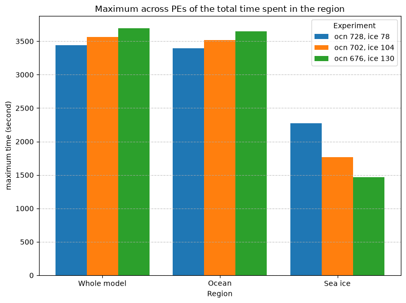

# Best layout for a budget

Suppose you have a fixed number of cores to run your application on. There are many ways of dividing these cores among
its components, and they are not all equally fast. Which one is the best? In this tutorial we try all the
parallelisation layouts that an allocation strategy finds for one number of cores, and pick the fastest. The experiments
are created as in [Generating and running experiments](experiments.md), with a single size. We use the `manager`,
`walltime`, `allocations` and `control_options` of that page, and the `groups` of [Choosing the
regions](analysing-data.md#choosing-the-regions). The figure is drawn from synthetic data.

## Choosing the layouts

=== "ACCESS-ESM1.6"

    The released configuration gives the UM, MOM5 and CICE5 256, 240 and 12 cores. Here we keep these numbers
    fixed, so the only thing that changes from one layout to the next is the process grid of each component:

    ```python
    from access.config.parallel_allocation_strategies import FixedAllocation, RootAllocation

    from access.profiling.models.esm16 import ESM16_PI_CONTROL_CORES

    released = RootAllocation(
        subcomponents={component: FixedAllocation(cores) for component, cores in ESM16_PI_CONTROL_CORES.items()}
    )
    layouts = manager.select_layouts(5 * 104, allocations=released)
    for layout in layouts:
        print(manager.application.experiment_name(layout))
    ```

    This prints the names of the layouts:

    ```text
    esm1p6-layout_piControl_atm_16x16_mom_10x24_ice_12
    esm1p6-layout_piControl_atm_16x16_mom_12x20_ice_12
    esm1p6-layout_piControl_atm_16x16_mom_15x16_ice_12
    esm1p6-layout_piControl_atm_16x16_mom_16x15_ice_12
    esm1p6-layout_piControl_atm_16x16_mom_20x12_ice_12
    esm1p6-layout_piControl_atm_16x16_mom_24x10_ice_12
    esm1p6-layout_piControl_atm_16x16_mom_30x8_ice_12
    esm1p6-layout_piControl_atm_32x8_mom_10x24_ice_12
    esm1p6-layout_piControl_atm_32x8_mom_12x20_ice_12
    esm1p6-layout_piControl_atm_32x8_mom_15x16_ice_12
    esm1p6-layout_piControl_atm_32x8_mom_16x15_ice_12
    esm1p6-layout_piControl_atm_32x8_mom_20x12_ice_12
    esm1p6-layout_piControl_atm_32x8_mom_24x10_ice_12
    esm1p6-layout_piControl_atm_32x8_mom_30x8_ice_12
    ```

    There are 14 layouts. They all leave the same 12 of the 520 cores idle, and only differ in the process grids
    of the UM, which is 16 × 16 or 32 × 8, and of MOM5. The layout of the release is the fourth one. If you also
    let the number of cores of each component change, as in
    [Getting started](../getting-started.md#previewing-a-study), you get 156 layouts on the same five nodes.

=== "ACCESS-OM3"

    With the allocation strategy of
    [Generating and running experiments](experiments.md#choosing-an-allocation-strategy), 26 nodes, the size of
    the release, admit three layouts:

    ```python
    layouts = manager.select_layouts(26 * 104, allocations=allocations(26))
    for layout in layouts:
        print(manager.application.experiment_name(layout))
    ```

    This prints:

    ```text
    om3-layout_MC-25km_atm_255_cpl_255_ice_255_ocn_2445_rof_255
    om3-layout_MC-25km_atm_270_cpl_270_ice_270_ocn_2430_rof_270
    om3-layout_MC-25km_atm_255_cpl_255_ice_255_ocn_2430_rof_255
    ```

    They leave 4, 4 and 19 of the 2704 cores idle.

## Generating and running them

We create the experiments with
[`generate_scaling_experiments`][access.profiling.manager.ProfilingManager.generate_scaling_experiments], as for
any other study. Since we only want one size, `num_nodes_list` has a single number:

=== "ACCESS-ESM1.6"

    ```python
    manager.generate_scaling_experiments(
        num_nodes_list=[5],
        cores_per_node=104,
        walltime=walltime,
        allocations=released,
        control_options=control_options,
    )
    ```

=== "ACCESS-OM3"

    ```python
    manager.generate_scaling_experiments(
        num_nodes_list=[26],
        cores_per_node=104,
        walltime=walltime,
        allocations=allocations,
        control_options=control_options,
    )
    ```

Then run them:

```python
manager.run_experiments()
```

Note that all the layouts run as jobs of the same size, even if some of them leave a few cores idle. This is
because both models always request the whole number of cores from the scheduler, ACCESS-ESM1.6 as `ncpureq` and
ACCESS-OM3 as `ncpus`. Here this means 14 jobs of five nodes, or 3 jobs of 26 nodes.

## Picking the fastest

To find the fastest layout, we look at the time the whole model took. This is a region of one of the logs, which
depends on the model:

=== "ACCESS-ESM1.6"

    ```python
    log, region = "payu", "payu_model_run_duration_seconds"
    ```

=== "ACCESS-OM3"

    ```python
    log, region = "ESMF", "[ensemble] RunPhase1"
    ```

Then read the logs and select the fastest experiment:

```python
from access.profiling.metrics import tmax

manager.parse_profiling_data()
names = [manager.application.experiment_name(layout) for layout in layouts]
parsed = [name for name in names if name in manager.data]
best = manager.select_best_experiments(log, region, tmax, experiments=parsed)
```

[`select_best_experiments`][access.profiling.manager.ProfilingManager.select_best_experiments] keeps the fastest
experiment for each number of CPUs. Here all the layouts use the same number of CPUs, so `best` contains a single
name. We pass the list of experiments for two reasons. First, the manager may hold other experiments, which we do
not want to include. Second, some experiments may not have finished. Note that an experiment without parsed data
would make the method raise a `KeyError`. We recommend choosing a region that covers the whole run, as we do
here. If you choose the region of a single component, you get the layout that is best for that component only.

## Ranking every layout

What if you want to see all the layouts, from the fastest to the slowest? `select_best_experiments` only gives
the best one, so we use the data directly:

```python
times = {name: float(manager.data[name][log][tmax].sel(region=region).pint.dequantify()) for name in parsed}
ranking = sorted(times, key=times.get)
for name in ranking:
    print(f"{times[name]:8.1f} s  {name}")
```

This prints the layouts from the fastest to the slowest, with the time each took.

## Comparing the fastest layouts

To understand why some layouts are faster than others, we can compare them region by region with
[`plot_bar_chart`][access.profiling.manager.ProfilingManager.plot_bar_chart]. We take the three fastest layouts:

```python
fig = manager.plot_bar_chart(groups, tmax, experiments=ranking[:3])
```

<figure markdown="span">
  
  <figcaption>Three layouts of the same 832 cores, sharing them out differently between the ocean and the sea
  ice. Synthetic data.</figcaption>
</figure>

In the example, giving the sea ice more cores makes it faster, and yet the whole model gets slower. Why? The cores
come from the ocean, which the whole model waits for. The chart gets wider with every experiment, so it is best to
compare only a few layouts at a time. [Comparing experiments](comparing-experiments.md) explains the chart further.

## Using the fastest layout

Now that we know which layout is the fastest, how do we use it? The application can tell us which changes to
make to the configuration files. With Payu, you can also find these changes in the branch of the layout, in
`<work_dir>/config`, together with its walltime and its name. Ask the application for the changes of the fastest
layout:

```python
from pprint import pprint

pprint(manager.application.config_changes(layouts[names.index(best[0])]))
```

For the release's own layout of ACCESS-ESM1.6, for example, they are:

```text
{'atmosphere/um_env.yaml': {'UM_ATM_NPROCX': '16',
                            'UM_ATM_NPROCY': '16',
                            'UM_NPES': '256'},
 'config.yaml': {'ncpureq': 520,
                 'submodels': [[{'ncpus': 256},
                                {'ncpus': 240},
                                {'exe': ['cice_access.exe'], 'ncpus': 12},
                                'PRESERVE']]},
 'ice/cice_in.nml': {'domain_nml': {'block_size_x': '30',
                                    'block_size_y': '300',
                                    'max_blocks': '1',
                                    'nprocs': '12',
                                    'nx_global': '360',
                                    'ny_global': '300'}},
 'ocean/input.nml': {'ocean_model_nml': {'layout': '16, 15'}}}
```

Keep in mind that the differences between the layouts are often small. If the timings change as much from one
run to the next, the ranking does not mean much. [Run-to-run variability](run-to-run-variability.md) shows how to
check this, and how to rank the layouts by their fastest or their typical run.
