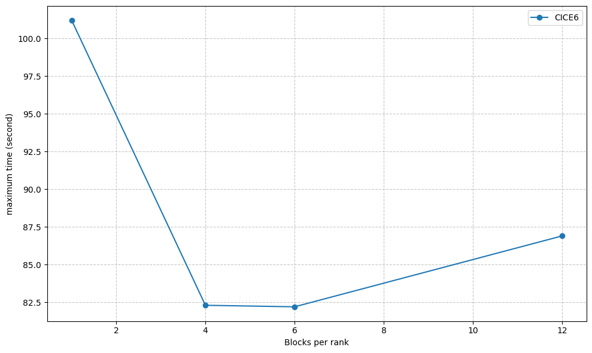

# Configuration choices

Does another setting of the sea ice make the model faster? Which value of a setting suits a parallelisation layout
best? Studies like these compare configurations of the application that differ in a setting, and not only in their
layout. In this tutorial we create one experiment for each configuration that we want to compare, all with a single
manager, and then compare them in charts and tables. Our example is ACCESS-OM3 at 100 km, run with Payu, and two
settings of its sea ice model, CICE6. The figure is drawn from synthetic data.

## Creating the manager

A study has one manager and one application, and directories of its own. We create a
[`PayuManager`][access.profiling.payu_manager.PayuManager] as in
[Generating and running experiments](experiments.md#creating-the-manager), for the 100 km configuration:

```python
from pathlib import Path

from access.profiling import PayuManager
from access.profiling.models.om3 import OM3_MC_100KM, OM3_MC_100KM_JRA_RYF_SOURCE

manager = PayuManager(
    work_dir=Path("/scratch/tm70/model_scaling/ACCESS-OM3/MC_100km_cice"),
    archive_dir=Path("/g/data/tm70/model_scaling/ACCESS-OM3/MC_100km_cice/archive"),
    application=OM3_MC_100KM,
    control=OM3_MC_100KM_JRA_RYF_SOURCE,
    lab_dir=Path("/scratch/tm70/model_scaling"),
)
```

The three directories are only examples, so adapt them to your own setup, replacing `tm70` with your own project.

## Stating the choices

Each configuration that we want an experiment of is a
[`ConfigurationChoice`][access.profiling.experiment.ConfigurationChoice]. A choice has up to three parts:

- The `changes` are what the experiment changes in the files of the control. They are given for each file, in the
  same format as the control options.
- The `layout` is the layout that the experiment runs. Without one, the experiment keeps the layout of the
  control.
- The `labels` are keys and values of your own. They say what the choice is, to you and to anyone who reads the
  study later.

CICE6 divides its grid into blocks, and gives each of its ranks several of them. Our first question is how it hands
the blocks out to the ranks. This is the `distribution_type` of the `domain_nml` group of its namelist, `ice_in`. We
compare three of its values, on the layout of the control:

```python
from access.profiling import ConfigurationChoice

walltime = {"config.yaml": {"walltime": "2:00:00"}}

distributions = [
    ConfigurationChoice(
        {**walltime, "ice_in": {"domain_nml": {"distribution_type": f"'{distribution}'"}}},
        labels={"distribution": distribution},
    )
    for distribution in ("cartesian", "roundrobin", "sectrobin")
]
```

There are three things to note here:

- The changes use the format of
  [experiment-generator](https://access-experiment-generator.access-hive.org.au/), which is what the Payu manager
  creates the experiments with. [Experiments with Payu](../access/payu.md#the-changes-of-a-choice) describes it.
- A string of a Fortran namelist is given with its own quotes, as in `"'roundrobin'"`. Without them, the value is
  written into the namelist without quotes.
- The walltime is one of the changes. It is the `walltime` of Payu's `config.yaml`, as a string. A choice that
  gives none keeps the walltime of the control.

## Generating the experiments

We create the experiments with
[`generate_experiments`][access.profiling.manager.ProfilingManager.generate_experiments]. It creates one experiment
for each choice, and searches for nothing:

```python
from ruamel.yaml.scalarstring import DoubleQuotedScalarString

control_options = {
    "config.yaml": {
        "manifest": {"reproduce": {"exe": False}},
        "postscript": "REMOVE",
        "mem": "REMOVE",
        "env": {
            "ESMF_RUNTIME_PROFILE": DoubleQuotedScalarString("on"),
            "ESMF_RUNTIME_PROFILE_OUTPUT": DoubleQuotedScalarString("SUMMARY"),
        },
    },
}

manager.generate_experiments(distributions, control_options=control_options)

for name, experiment in manager.experiments.items():
    print(name, experiment.labels)
```

The control options are applied to the control before the experiments are created, as in
[Generating the experiments](experiments.md#generating-the-experiments). Here they turn on the ESMF profiling
summary, and remove what the control only needs for production runs. This prints the experiments and their labels:

```text
exp-0001 {'distribution': 'cartesian'}
exp-0002 {'distribution': 'roundrobin'}
exp-0003 {'distribution': 'sectrobin'}
```

The experiments are numbered in the order of the choices. Their names say nothing about them, so the labels are
how we tell them apart.

## Choices that include a layout

Our second question is the size of the blocks. The best size depends on the number of ranks of the sea ice, so
this time each choice also names a layout.

First we need the layout. We take the one of the control, which gives the ocean 288 cores and lets the mediator,
the data atmosphere, the sea ice and the data runoff take turns on 24 more:

```python
from access.config.parallel_allocation_strategies import FixedAllocation, RootAllocation, WholeRangeAllocation

released = RootAllocation(
    subcomponents={
        "ocn": FixedAllocation(288),
        "shared": FixedAllocation(
            24,
            subcomponents={name: WholeRangeAllocation() for name in ("cpl", "atm", "ice", "rof")},
        ),
    }
)
(layout,) = manager.select_layouts(3 * 104, allocations=released)
print(manager.application.layout_key(layout))
```

This prints the key of the one layout that the strategy finds on three nodes of 104 cores:

```text
om3-layout_MC-100km_atm_24_cpl_24_ice_24_ocn_288_rof_24
```

Next we need a block size for each choice. The application chooses the block size from the number of ranks, so
that each rank holds between 5 and 8 blocks. We ask it for the block sizes of other ranges, and state each of them
in a choice:

```python
from dataclasses import replace

from access.profiling.manager import find_component

sea_ice = manager.application.sea_ice
ice_ranks = find_component(layout, "ice").n_ranks

block_sizes = []
for blocks_per_rank in ((1, 1), (2, 4), (5, 8), (9, 16)):
    blocks = replace(sea_ice, blocks_per_rank_range=blocks_per_rank)
    block_sizes.append(
        ConfigurationChoice(
            {**walltime, "ice_in": {"domain_nml": blocks.namelist_changes(ice_ranks)}},
            layout=layout,
            labels={"blocks per rank": blocks.blocks(ice_ranks).blocks_per_rank},
        )
    )

for choice in block_sizes:
    entries = choice.changes["ice_in"]["domain_nml"]
    print(choice.labels, entries["block_size_x"], "x", entries["block_size_y"])
```

This prints the label and the block size of each choice:

```text
{'blocks per rank': 1} 15 x 324
{'blocks per rank': 4} 15 x 81
{'blocks per rank': 6} 15 x 54
{'blocks per rank': 12} 15 x 27
```

Here `find_component` gives the part of the layout that belongs to the sea ice, which has 24 ranks. `replace` makes
a copy of the sea ice settings of the application with another range of blocks per rank. The ranks then hold 1, 4,
6 or 12 blocks each. The entries of a choice also state the grid again, and leave `max_blocks` for CICE6 to work
out, as the application does for every layout.

With a layout, the changes of an experiment are put together from two sources. The application says what the
layout comes to: the numbers of cores in `config.yaml` and `nuopc.runconfig`, and the grid and the blocks in
`ice_in`. The changes of the choice are then merged over these, so that the choice has the last word. Here this
replaces the block size that the application chose.

A study of the block size usually asks the same question on several layouts, since the best size depends on the
number of ranks.
[`block_size_choices`][access.profiling.models.om3.OM3Configuration.block_size_choices] makes these choices for
you, one for each range of blocks per rank and each layout. The ranges are given under labels of your own, and the
changes that all the choices share are given apart:

```python
by_range = manager.application.block_size_choices([layout], {"2-4": (2, 4), "9-16": (9, 16)}, changes=walltime)

for choice in by_range:
    entries = choice.changes["ice_in"]["domain_nml"]
    print(choice.labels, entries["block_size_x"], "x", entries["block_size_y"])
```

This prints the label and the block size of each choice:

```text
{'blocks per rank': '2-4'} 15 x 81
{'blocks per rank': '9-16'} 15 x 27
```

The labels have the key `blocks per rank`, and `label` gives them another one. A layout on which no block size gives
the ranks so many blocks is left out of that range, with an INFO message. Note that the changes cannot set the
`domain_nml` group of `ice_in` themselves, since every choice states it. Make such changes in the control options
instead.

Finally we create the experiments, with the same call as before:

```python
manager.generate_experiments(block_sizes, control_options=control_options)

for name, experiment in manager.experiments.items():
    print(name, manager.layout_key(name), experiment.labels)
```

The calls add up, so the study now has seven experiments:

```text
exp-0001 None {'distribution': 'cartesian'}
exp-0002 None {'distribution': 'roundrobin'}
exp-0003 None {'distribution': 'sectrobin'}
exp-0004 om3-layout_MC-100km_atm_24_cpl_24_ice_24_ocn_288_rof_24 {'blocks per rank': 1}
exp-0005 om3-layout_MC-100km_atm_24_cpl_24_ice_24_ocn_288_rof_24 {'blocks per rank': 4}
exp-0006 om3-layout_MC-100km_atm_24_cpl_24_ice_24_ocn_288_rof_24 {'blocks per rank': 6}
exp-0007 om3-layout_MC-100km_atm_24_cpl_24_ice_24_ocn_288_rof_24 {'blocks per rank': 12}
```

The first three experiments were given no layout, so they have no key, which is printed as `None`. The other four
all run the same layout, and only their labels tell them apart.

!!! warning
    Nothing checks the changes of a choice against its layout. The application works out what a layout comes to
    from its own settings, and not from the changes of the choice. For example, `OM3_MC_100KM` chooses its blocks
    for a `cartesian` distribution. A choice that names a layout and changes the `distribution_type` still gets the
    blocks of the `cartesian` distribution, unless it states the blocks as well.

## What the manager recognises

The manager recognises a choice that the study already has an experiment for. It compares the layout and the
changes of the choice with the [records](managing-experiments.md#what-the-manager-keeps-on-disk) of the experiments.
This has a few consequences:

- You can call `generate_experiments` again with the same choices, for example in a later session. The choices
  that already have an experiment are skipped, and only the new ones are created.
- The labels are not compared. An experiment that is found again keeps the labels it has. If the choice gives
  other labels, the manager logs a warning.
- Two choices of one call with the same layout and the same changes raise a `ValueError`. A study has one
  experiment for each configuration.
- The experiments of a scaling study have a layout and no changes. A choice with the same layout and no changes
  is therefore the same experiment, and `generate_scaling_experiments` skips the layouts that such choices
  already cover.

There are also a few things a choice cannot do:

- With a layout, a choice cannot give a list for a key that the application also gives a list for, such as the
  `submodels` of ACCESS-ESM1.6. This raises a `ValueError`, because only experiment-generator knows how to merge
  two lists. If every experiment needs the change, make it in the control options instead.
- A choice cannot set the `laboratory` or the `experiment` of `config.yaml`. The manager sets both itself, and
  raises a `ValueError` if a choice names one of them.
- The changes and the labels must be JSON values, since they are written to the records. Use lists and not
  tuples, and strings as keys. Otherwise the choice raises a `ValueError` when it is created.
- A failed experiment is not created again with corrected changes, as `regenerate_failed` does for a scaling
  study. Different changes are a different experiment. Delete the failed experiment and create the corrected one.

## Running and comparing

The experiments are run and followed as in any other study:

```python
manager.run_experiments()
```

[Managing experiments](managing-experiments.md) shows how to follow them, and how to archive them once they have
finished. We then read the logs and choose the regions to look at, as in
[Analysing profiling data](analysing-data.md):

```python
from access.profiling import RegionGroup
from access.profiling.metrics import tmax

manager.parse_profiling_data()

whole = RegionGroup("ESMF", ["[ensemble] RunPhase1"], relabel={"[ensemble] RunPhase1": "Whole model"})
cice6 = RegionGroup("ESMF", ["[ICE] RunPhase1"], relabel={"[ICE] RunPhase1": "CICE6"})
```

Both regions come from the ESMF profiling summary. The first one times the whole model, and the second one the
sea ice.

To compare the three distributions, we draw a bar chart, as in [Comparing experiments](comparing-experiments.md).
We select the experiments by their labels, and use the labels to name the bars:

```python
distributed = [name for name, experiment in manager.experiments.items() if "distribution" in experiment.labels]

fig = manager.plot_bar_chart([whole, cice6], tmax, experiments=distributed, label="distribution")
```

This draws one group of bars for the whole model and one for CICE6, with a bar for each distribution. With
`label`, the bars of each experiment are named by the value of a coordinate, such as `distribution roundrobin`. Each
experiment must therefore have a value of its own. Otherwise the method raises a `ValueError` that names the
experiments. To give the bars names of your own instead, use `experiment_relabel_map`, but not together with
`label`.

## Putting the experiments in a table

The block sizes are numbers, so we can do more with them than name bars.
[`gather`][access.profiling.manager.ProfilingManager.gather] collects the regions of a group, for several
experiments, into one dataset. The names of the experiments say nothing about them, so we also ask for what tells
the experiments apart:

```python
from access.profiling.manager import component_cores

sized = [name for name, experiment in manager.experiments.items() if "blocks per rank" in experiment.labels]
gathered = manager.gather(cice6, ["blocks per rank", component_cores("ice")], experiments=sized)
```

What tells the experiments apart is given as a list of coordinates. A coordinate is one of two things:

- A string is the key of a label. Here `"blocks per rank"` gives the label of each experiment.
- An [`ExperimentCoordinate`][access.profiling.experiment.ExperimentCoordinate] is a quantity of the layout of each
  experiment. Here [`component_cores`][access.profiling.manager.component_cores] gives the number of cores of the
  sea ice, under the name `ice cores`.

The dataset has the experiments along a dimension named `experiment`, and the regions along `region`, under the
labels of the group. Each coordinate has one value for each experiment. We print them next to the times:

```python
times = gathered[tmax].sel(region="CICE6").pint.dequantify()
for blocks, cores, seconds in zip(times["blocks per rank"].values, times["ice cores"].values, times.values):
    print(f"{blocks:2d} blocks per rank on {cores} cores: {seconds:7.1f} s")
```

This prints one line for each experiment, with its blocks per rank, the cores of its sea ice and the time that
CICE6 took.

A table is often easier to read. [`table`][access.profiling.manager.ProfilingManager.table] collects a metric in
the same way, and puts it in a pandas `DataFrame`, with a row for each value of one coordinate and a column for
each value of another:

```python
table = manager.table(cice6, tmax, component_cores("ice"), "blocks per rank", experiments=sized)
print(table)
```

This prints the time of CICE6 with a row for each number of cores of the sea ice, here only 24, and a column for
each number of blocks per rank. There are a few things to know about the table:

- The rows are sorted by their value. The columns are in the order in which the experiments give their values.
- The columns are grouped by region, under the labels of the group. Without the second coordinate, there is one
  column for each region.
- The numbers are in the units of the metric. The table names these units in `table.attrs["units"]`.
- An empty cell means that no experiment has that pair of values. If two experiments have the same pair, the
  method raises a `ValueError` that names them, since a cell holds one value.
- Like `gather`, the method takes `runs`, to reduce the runs of each experiment without replacing the parsed data.
  [Run-to-run variability](run-to-run-variability.md#reducing-the-runs-without-replacing-them) explains this.

To look at only some of the experiments, pick them out by a value of a coordinate with
[`select_experiments`][access.profiling.manager.ProfilingManager.select_experiments]. For example, these are the
experiments that give the sea ice 24 cores:

```python
on_24_cores = manager.select_experiments(component_cores("ice"), 24)
```

The method returns the names of the experiments, which you can give to a table or a plot as `experiments`. It
selects from the experiments with parsed data, because those are the ones a table or a plot can read. To select
from a list of your own instead, give it as `experiments`.

You can also define a coordinate of your own. It needs a name, and a function that works the quantity out from a
layout. For example, this one is the number of cores of the whole layout:

```python
from access.profiling import ExperimentCoordinate

layout_cores = ExperimentCoordinate("layout cores", lambda layout: layout.n_cores)
```

A layout may not have the quantity that a coordinate reads, such as the cores of a component that the layout does
not hold. The function then has to raise a `ValueError`, and the manager says which experiment the layout belongs
to.

## Plotting against a setting

[`plot_metric`][access.profiling.manager.ProfilingManager.plot_metric] draws a metric against a coordinate. We plot
the time of CICE6 against the number of blocks of each rank:

```python
fig = manager.plot_metric([cice6], tmax, "blocks per rank", experiments=sized, xlabel="Blocks per rank")
```

<figure markdown="span">
  
  <figcaption>The time of CICE6 for four block sizes on the same layout. Synthetic data.</figcaption>
</figure>

Each region is one line, and each experiment is placed along the x-axis by its value of the coordinate. In the
example, the sea ice is fastest with 4 to 6 blocks on each rank. Both axes are linear, and there is no line of
ideal scaling, because the coordinate does not have to be a number of cores.

There are a few things to know about this plot:

- The values of the coordinate must be numbers. If a label holds a string, the method raises a `ValueError`. Use
  a bar chart for such a label.
- If several experiments have the same value of the coordinate, the fastest of them is plotted. The manager
  names these experiments in an INFO message.
- With `series`, the experiments are first divided by a second coordinate. Each region then has one line for
  each value of that coordinate.

For example, a study may run these block sizes on several layouts. This call then draws one line for each number
of cores of the sea ice:

```python
fig = manager.plot_metric([cice6], tmax, "blocks per rank", series=component_cores("ice"), experiments=sized)
```

Each line is labelled with its region and its value of the series, such as `CICE6, ice cores 24`. The series can
also be a label, and its values do not have to be numbers.
