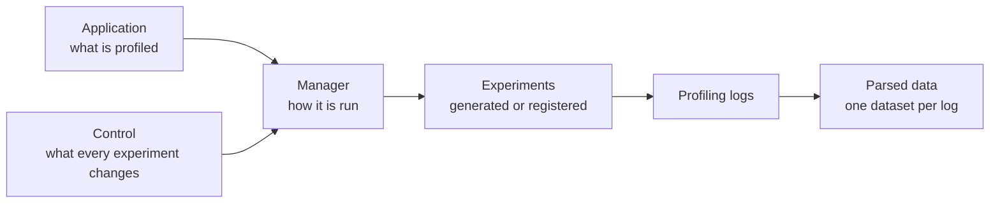
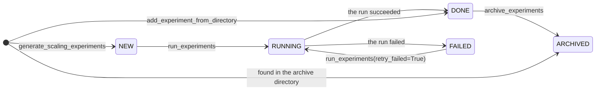

# Concepts

In a profiling study, you run an application one or more times and compare how long each part of it took. There
are several kinds of study, depending on what changes from one run to the next:

- when [comparing experiments](comparing-experiments.md), the build or the configuration of the application
  changes;
- when measuring [run-to-run variability](run-to-run-variability.md), nothing changes: the same experiment is
  simply run several times;
- when looking for the [best parallelisation layout of a budget](best-layout.md), the number of cores stays the same,
  but the way they are divided among the components of the application changes;
- in a [scaling study](scaling-studies.md), both the number of cores and the way they are divided change.

All of these studies are built from the same few pieces, which are introduced here. Once you know them, [Generating and
running experiments](experiments.md) and [Managing experiments](managing-experiments.md) show how to create and follow
the experiments, and [Logs and metrics](logs-and-metrics.md) and [Analysing profiling data](analysing-data.md) show how
to read their results. The study guides then put everything together. All the examples are for the ACCESS climate
models, which are described in [ACCESS models](../access/index.md).

## Applications, managers and controls

A study is defined by three independent parts:

- The **application** is what is profiled, for example one configuration of a climate model. It knows how the
  application is parallelised, which files need to be edited to change the number of cores, and which profiling
  logs a run writes. The package ships presets for the ACCESS models, such as
  [`ESM16_PI_CONTROL`][access.profiling.models.esm16.ESM16_PI_CONTROL]. See [ACCESS models](../access/index.md).
- The **manager** is how the application is run. A
  [`ProfilingManager`][access.profiling.manager.ProfilingManager] works with one workflow engine. It creates and
  runs the experiments, keeps track of them, archives them, reads their logs and plots the results. The package
  provides [`PayuManager`][access.profiling.payu_manager.PayuManager] for Payu and
  [`CylcRoseManager`][access.profiling.cylc_manager.CylcRoseManager] for Cylc Rose suites, the workflow engines of
  the ACCESS models.
- The **control** is the experiment that is modified to create the other experiments. It can be a git repository,
  given as a [`GitControlSource`][access.profiling.control.GitControlSource] with a tag, branch or commit, or a
  directory that is already on disk, given as an
  [`ExistingDirectoryControlSource`][access.profiling.control.ExistingDirectoryControlSource]. Note that a control
  source only says where the control is. The workflow engine is the one that fetches it, or that expects it to be
  there already.



You can combine any application with any control. This means that, to profile a fork or a later release of a
configuration, you only need to give the manager a different control. There is no need to define a new
application.

## Parallelisation layouts

A parallelisation layout, or layout for short, says how many cores each component of the application gets. For the
components that split their domain over a grid of processes, it also gives the shape of that grid. For example, the
first layout of ACCESS-ESM1.6 found in [Getting started](../getting-started.md) gives the UM 252 cores in an 18 × 14
grid, MOM5 256 cores in a 16 × 16 grid, and CICE5 12 cores.

The manager finds the layouts of an application by searching for them, using
[access-config-utils](https://github.com/ACCESS-NRI/access-config-utils). The application describes its components
as a tree, together with what it needs in order to run at all. In ACCESS-ESM1.6, for example, the UM needs an even
number of processes along x, and no layout may leave more than 10% of its cores idle. You will usually not want
every possible layout, so an allocation strategy lets you narrow the search down: it sets how many cores each
component may get, and can add further constraints. These limits can be given as fractions of the total number of
cores, so the same strategy can be used for every size of a study.

The layouts are returned sorted by the number of cores they leave idle. Each layout becomes one experiment, and the
name of the experiment is built from the layout. This means that the same layout always gives the same experiment.

When the results are plotted, there are two numbers of cores to keep in mind. The first is the number of cores the
job occupied. This is what the scheduler charged for, and it can be larger than the number of cores the layout
uses. Payu, for example, requests whole nodes of NCI's Gadi, so a layout of 508 cores on its 104-core nodes
occupies 520. The second is the number of cores each component was given, which is its own share of those. The
scaling plot uses the first number, and the component scaling plot uses the second.

## Experiments and their statuses

Each experiment held by a manager has a status:



The manager does not wait for the experiments to finish. Instead, it checks how each run went by reading the
records that the workflow engine keeps. This happens whenever
[`update_statuses`][access.profiling.manager.ProfilingManager.update_statuses] is called, and running, archiving
and parsing experiments all call it first. Note that the statuses are only kept in memory. A manager created in a
new session therefore only knows about the experiments it can find: the ones in its archive directory, which are
ARCHIVED. [Managing experiments](managing-experiments.md) explains how to get the other experiments back.

## Profiling data

When an application runs, it writes profiling logs. These are the timers of each of its components, and the
records that the workflow engine keeps of each job. Each log is read by a parser, which returns a few numbers,
called metrics, for every region that the log times.
[`parse_profiling_data`][access.profiling.manager.ProfilingManager.parse_profiling_data] reads the logs of every
finished experiment and stores the results in `manager.data`. There you will find one
[xarray](https://docs.xarray.dev/en/stable/) dataset per log, organised by experiment name and then by log name.

For example, here is what the MOM5 timers of a run on 49 PEs look like once parsed:

```text
<xarray.Dataset> Size: 2kB
Dimensions:        (region: 8)
Coordinates:
  * region         (region) <U31 992B 'Total runtime' 'Ocean' ... 'oasis_send'
Data variables:
    minimum time   (region) float64 64B [s] 1.628e+04 1.597e+04 ... 168.8 2.469
    maximum time   (region) float64 64B [s] 1.628e+04 1.6e+04 ... 171.6 2.757
    average time   (region) float64 64B [s] 1.628e+04 1.599e+04 ... 170.5 2.594
    time std       (region) float64 64B [s] 1e-06 8.644 ... 0.6509 0.07946
    time fraction  (region) float64 64B [%] 100.0 98.2 0.0 0.0 0.0 0.0 1.0 0.0
    grain          (region) int64 64B [] 0 1 11 11 31 1 31 31
    lowest PE      (region) int64 64B [] 0 0 0 0 0 0 0 0
    highest PE     (region) int64 64B [] 48 48 48 48 48 48 48 48
```

The dataset has a `region` dimension with the names of the regions, exactly as they appear in the log. Each metric
is a data variable, with its units. If an experiment ran several times, its datasets also have a `run` dimension,
and [Run-to-run variability](run-to-run-variability.md) explains what to do with it. If a log reported every PE
separately, its dataset would have a `pe` dimension. Finally, the scaling plots add an `ncpus` dimension when they
put the experiments of a study together.

Note that the data variables are accessed with the metric objects themselves, which are defined in
`access.profiling.metrics`, and not with their names. With `ds` holding the dataset above, select the maximum time
of the ocean:

```python
from access.profiling.metrics import tmax

ocean = ds[tmax].sel(region="Ocean")
print(ocean.data)
```

This prints the value with its unit:

```text
16000.70455 second
```

Be aware that `ds["maximum time"]` raises a `KeyError`, even though that is the name shown when the dataset is
printed. The values carry their units thanks to [pint-xarray](https://pint-xarray.readthedocs.io/en/stable/), so
you can convert them, for example with `ocean.pint.to("hour")`. [Logs and metrics](logs-and-metrics.md) explains
what each metric means, and [Log formats](../access/log-formats.md) describes the logs of the ACCESS models.

## Choosing the regions to plot

The logs of an application usually time many more regions than you can show in one plot. For this reason, the
plotting methods take a list of [`RegionGroup`][access.profiling.plotting_utils.RegionGroup]s. Each group names a
log and the regions to take from it. For example, this group takes the region `um_total_walltime` of the log
`UM_Total_Walltime`, and labels it `UM`:

```python
from access.profiling import RegionGroup

RegionGroup("UM_Total_Walltime", ["um_total_walltime"], relabel={"um_total_walltime": "UM"})
```

Each region becomes a line or a bar in the plot. By default it is labelled `"<log>: <region>"`, and you can use
`relabel` to give it another label. A group can also name the `component` of the layout that its regions ran on.
This is only needed by the component scaling plot, and only for logs that cover several components.
[Analysing profiling data](analysing-data.md) shows the groups in use.
