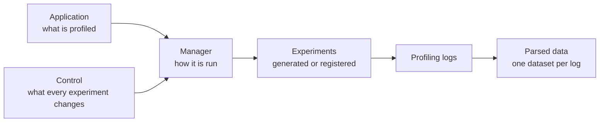
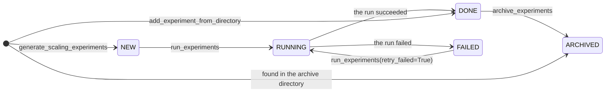

# Concepts

A profiling study runs an application one or more times and compares how long each part of it took. What its runs
differ in is what the study asks about:

- when [comparing experiments](comparing-experiments.md), the build or the configuration of the application;
- nothing at all, when the same experiment is run several times to measure
  [run-to-run variability](run-to-run-variability.md);
- in a search for the [best layout of a budget](best-layout.md), how one number of cores is divided among the
  application's components;
- or, in a [scaling study](scaling-studies.md), the number of cores as well as how they are divided.

Every study is built from the same few pieces, which are introduced here.
[Generating and running experiments](experiments.md) and [Managing experiments](managing-experiments.md) then
produce and follow the experiments, [Logs and metrics](logs-and-metrics.md) and
[Analysing profiling data](analysing-data.md) read them, and the study guides put both to work. The examples are
taken from the implementations the package provides for the ACCESS climate models, which
[ACCESS models](../access/index.md) describes.

## Applications, managers and controls

Three independent choices define a study:

- The **application** is what is profiled: one setup of one parallel application. It says which components the
  application runs and over which domains, how a layout is written into its configuration files and read back out
  of them, and which profiling logs a run writes. The package ships presets for the ACCESS models, such as
  [`ESM16_PI_CONTROL`][access.profiling.models.esm16.ESM16_PI_CONTROL]. See [ACCESS models](../access/index.md).
- The **manager** is how it is run: a [`ProfilingManager`][access.profiling.manager.ProfilingManager] for one
  workflow engine. It generates and runs the experiments, tracks them, archives them, parses their logs and plots
  the results. The package provides [`PayuManager`][access.profiling.payu_manager.PayuManager] for Payu and
  [`CylcRoseManager`][access.profiling.cylc_manager.CylcRoseManager] for Cylc Rose suites, the workflow engines of
  the ACCESS models.
- The **control** is where the configuration that every experiment changes comes from. A
  [`GitControlSource`][access.profiling.control.GitControlSource] names a repository and a tag, branch or commit,
  and an [`ExistingDirectoryControlSource`][access.profiling.control.ExistingDirectoryControlSource] names a
  directory that is already checked out. Note that a control source only records where the control is: the
  manager's workflow engine fetches it, or expects it to be there already.



Any application can be paired with any control. To profile a fork or a later release of a configuration, pass a
different control to the manager; there is no need to define a new application.

## Layouts

A layout says how many cores each component of the application receives and, for the components that decompose a
domain themselves, the process grid it is decomposed over. For example, the first layout of ACCESS-ESM1.6 found in
[Getting started](../getting-started.md) gives the UM 252 cores in an 18 × 14 grid, MOM5 256 cores in a 16 × 16
grid, and CICE5 12 cores.

A manager finds the layouts of an application with a layout search over its component tree, which
[access-config-utils](https://github.com/ACCESS-NRI/access-config-utils) provides. The tree states the
requirements that every layout must meet, for any study. In ACCESS-ESM1.6, for example, the UM needs an even number
of processes along x, and no layout may leave more than 10% of its cores idle. An allocation strategy then narrows
the search down to the layouts a particular study wants, with bounds on the cores of each component and further
constraints. Since the bounds can be given as fractions of the total, a single strategy serves every size of a
study.

The layouts come back sorted by the number of cores they leave idle. Each becomes an experiment, whose name is
derived from the layout, so the same layout always gives the same experiment at any size of the study.

Two numbers of cores matter when the results are plotted. The first is the cores a job occupied, which are what the
scheduler charged for, and can be more than the layout puts to work. Payu, for example, requests whole nodes of
NCI's Gadi, so a layout of 508 cores on its 104-core nodes occupies 520. The second is the cores a component was
given, its own share of those. The scaling plot reads every region against the first, and the component scaling
plot reads each region against the second.

## Experiments and their statuses

Each experiment held by a manager has a status:



A manager does not wait for a run to finish. Whenever
[`update_statuses`][access.profiling.manager.ProfilingManager.update_statuses] is called, it learns what became of
each run from the records the workflow engine leaves behind. Running, archiving and parsing experiments all call it
first. Note that the statuses are held in memory, so a manager created in a new session starts from what it can
find: the experiments in its archive directory are ARCHIVED, and [Managing experiments](managing-experiments.md)
explains how to get the others back.

## Profiling data

An application writes profiling logs: the timers of each component, and the job records of the workflow engine. A
parser reads each log and reports a few statistics, called metrics, for every region the log times.
[`parse_profiling_data`][access.profiling.manager.ProfilingManager.parse_profiling_data] reads the logs of every
finished experiment into `manager.data`. That holds one [xarray](https://docs.xarray.dev/en/stable/) dataset per
log, keyed by experiment name and then by log name.

For example, here is what the MOM5 timers of a run on 49 PEs look like once parsed:

```text
<xarray.Dataset> Size: 2kB
Dimensions:        (region: 8)
Coordinates:
  * region         (region) <U31 992B 'Total runtime' 'Ocean' ... 'oasis_send'
Data variables:
    minimum time   (region) float64 64B [s] 1.628e+04 1.597e+04 ... 168.8 2.469
    maximum time   (region) float64 64B [s] 1.628e+04 1.6e+04 ... 171.6 2.757
    average time   (region) float64 64B [s] 1.628e+04 1.599e+04 ... 170.5 2.594
    time std       (region) float64 64B [s] 1e-06 8.644 ... 0.6509 0.07946
    time fraction  (region) float64 64B [%] 100.0 98.2 0.0 0.0 0.0 0.0 1.0 0.0
    grain          (region) int64 64B [] 0 1 11 11 31 1 31 31
    lowest PE      (region) int64 64B [] 0 0 0 0 0 0 0 0
    highest PE     (region) int64 64B [] 48 48 48 48 48 48 48 48
```

The dataset has a `region` dimension, holding the names of the regions as the log writes them, and one data
variable per metric, with its units. An experiment run several times has a `run` dimension as well, and
[Run-to-run variability](run-to-run-variability.md) explains how to reduce it. A log reporting every PE separately
would have a `pe` dimension, and the scaling plots add an `ncpus` dimension when they put the experiments of a
study together.

Note that the data variables are keyed by the metric objects themselves, which are defined in
`access.profiling.metrics`, and not by their names. With `ds` holding the dataset above, select the maximum time
of the ocean:

```python
from access.profiling.metrics import tmax

ocean = ds[tmax].sel(region="Ocean")
print(ocean.data)
```

This prints the value with its unit:

```text
16000.70455 second
```

Be aware that `ds["maximum time"]` raises a `KeyError`, even though that is the name the dataset is printed with.
The values carry their units through [pint-xarray](https://pint-xarray.readthedocs.io/en/stable/), so
`ocean.pint.to("hour")` converts them. [Logs and metrics](logs-and-metrics.md) says what each metric means, and
[Log formats](../access/log-formats.md) what the parsers for the logs of the ACCESS models read.

## Choosing the regions to plot

An application's logs time many more regions than a plot can show. The plotting methods are therefore given a list
of [`RegionGroup`][access.profiling.plotting_utils.RegionGroup]s, each naming a log and the regions to take from
it. For example, this group takes the region `um_total_walltime` of the log `UM_Total_Walltime`, and labels it `UM`:

```python
from access.profiling import RegionGroup

RegionGroup("UM_Total_Walltime", ["um_total_walltime"], relabel={"um_total_walltime": "UM"})
```

Each region becomes a line or a bar, labelled `"<log>: <region>"` unless `relabel` gives it another label. A group
can also name the `component` of the layout its regions ran on. Only the component scaling plot needs that, and
only for logs that cover several components. [Analysing profiling data](analysing-data.md) shows the groups in use.
