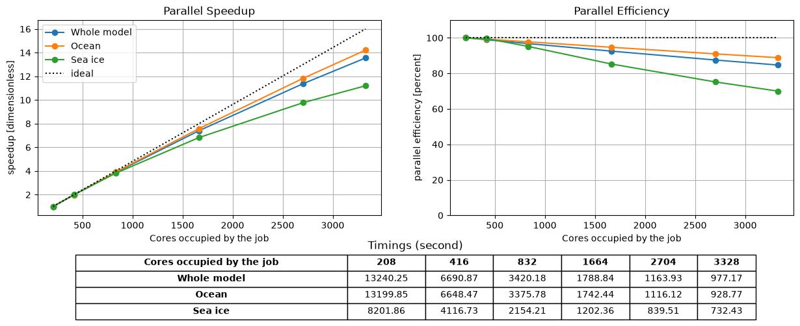
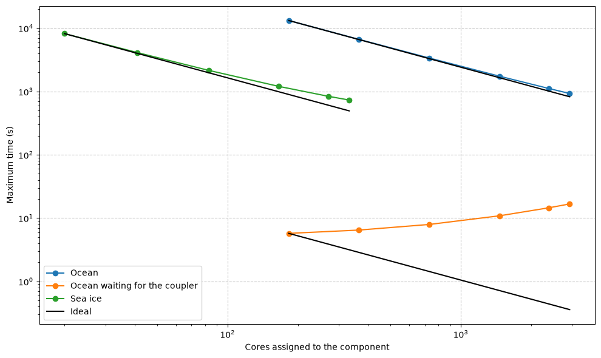

# Scaling studies

How much faster does your application run if you give it more cores? This is what a scaling study tells you. The
application is run on several numbers of cores, and we look at how the run time goes down, for the whole
application and for each of its components. The experiments are created as shown in
[Generating and running experiments](experiments.md), whose example is a scaling study. They can also be Rose
suites prepared by hand, as in [Cylc Rose suites](../access/cylc-rose-suites.md). In this tutorial we use the
`manager` of that page and the `groups` of [Choosing the regions](analysing-data.md#choosing-the-regions). The
figures are drawn from synthetic data, to show what each plot looks like and how to read it.

## The experiments of a scaling study

The sizes of the study are given in `num_nodes_list` when the experiments are created. In the example, this is 1 to 8
nodes for ACCESS-ESM1.6 and 1 to 32 for ACCESS-OM3. For each size, there is one experiment for each parallelisation
layout that the allocation strategy finds. If the limits of the strategy are fractions of the total number of cores, the
same strategy can be used for all the sizes. Be aware that the number of layouts grows quickly, so count them before
creating the study, as [Counting the layouts](experiments.md#counting-the-layouts) shows.

## Selecting the best layouts

A study usually has several layouts for each size, but the scaling plot needs exactly one experiment for each
number of cores. We therefore keep only the fastest experiment of each size, with
[`select_best_experiments`][access.profiling.manager.ProfilingManager.select_best_experiments]. It needs to know
which region to look at, and here we use the time the whole model took:

=== "ACCESS-ESM1.6"

    ```python
    from access.profiling.metrics import tmax

    best = manager.select_best_experiments("payu", "payu_model_run_duration_seconds", tmax)
    ```

=== "ACCESS-OM3"

    ```python
    from access.profiling.metrics import tmax

    best = manager.select_best_experiments("ESMF", "[ensemble] RunPhase1", tmax)
    ```

`best` is a list with the names of the experiments, sorted by number of CPUs. We will pass it to the plotting
methods. Since we chose a region that covers the whole run, these are the layouts that made the whole application
fastest.

## Scaling against the whole job

The first plot shows how well each region scales with the size of the job.
[`plot_scaling_data`][access.profiling.manager.ProfilingManager.plot_scaling_data] plots the parallel speedup and
efficiency of every region against the number of CPUs of the whole job, which is what the scheduler charged for:

```python
fig = manager.plot_scaling_data(groups, tmax, experiments=best, xlabel="Cores occupied by the job")
```

<figure markdown="span">
  
  <figcaption>The scaling plot of a coupled model whose ocean and sea ice run concurrently. Synthetic data.</figcaption>
</figure>

The speedup at $n$ cores is $S(n) = T(n_0) / T(n)$, where $T$ is the value of the metric and $n_0$ the smallest
number of cores in the plot, and the dotted line is the ideal speedup $n / n_0$. The efficiency is
$E(n) = S(n)\,n_0 / n$, in percent, so the ideal is 100%. The table underneath gives the metric itself. In the
example, the sea ice keeps 70% efficiency at 16 times the cores, and the ocean, which the whole model waits for,
almost 90%.

Keep in mind that every region is plotted against the cores of the whole job. The curve of a component therefore
does not show how well the component itself scales, but how its time changes as the whole job grows. Note also
that the speedup only makes sense with one experiment for each number of cores. If you pass two experiments of
the same size, the method raises an error, so pass the output of `select_best_experiments`.

## Scaling against each component's cores

To see how well each component itself scales, use
[`plot_component_scaling_data`][access.profiling.manager.ProfilingManager.plot_component_scaling_data]. It plots
every region against the number of cores of its own component:

```python
fig = manager.plot_component_scaling_data(groups, tmax, ylabel="Maximum time (s)")
```

<figure markdown="span">
  
  <figcaption>The component scaling plot of the same model, with a region in which the ocean waits for the
  coupler. Synthetic data.</figcaption>
</figure>

Both axes are logarithmic, which means that perfect scaling is a straight line. Each black line shows the time
that a region would take if every extra core was fully used, starting from the first point. The further a curve is
above its line, the less the extra cores helped. Some regions even go up instead of down. These are regions where
a component is waiting and not working. Why does the
ocean's wait for the coupler climb here? Given more cores, the ocean finishes its own work sooner, and waits longer
for the components that have not.

The number of cores of each component comes from the layout of each experiment. Unlike the previous plot, this
one can use all the experiments of a study. If several experiments give a component the same number of cores, the
fastest value is kept.

## Computing speedup and efficiency

You can also compute the speedup and the efficiency yourself. The functions used by the scaling plots are in
`access.profiling.scaling`, and work on any dataset with an `ncpus` coordinate. Here we build such a dataset from
the best experiments, whose numbers of CPUs were stored by `select_best_experiments`:

```python
import xarray as xr

from access.profiling.scaling import parallel_efficiency

stats = xr.concat(
    [manager.data[name]["MOM5"].expand_dims(ncpus=[manager.experiments[name].ncpus]) for name in best],
    dim="ncpus",
)
efficiency = parallel_efficiency(stats, tmax)
print(efficiency.sel(region="Total runtime"))
```

This prints the parallel efficiency of MOM5's total runtime at every number of CPUs.

## Rose suites

The scaling plot works in the same way for [Cylc Rose suites](../access/cylc-rose-suites.md). Their numbers of
CPUs are also the ones their jobs requested from PBS, as explained in
[Parsing and plotting](../access/cylc-rose-suites.md#parsing-and-plotting). The component scaling plot, however,
is not available for Rose suites, because the package cannot read the layout of a Rose suite.
